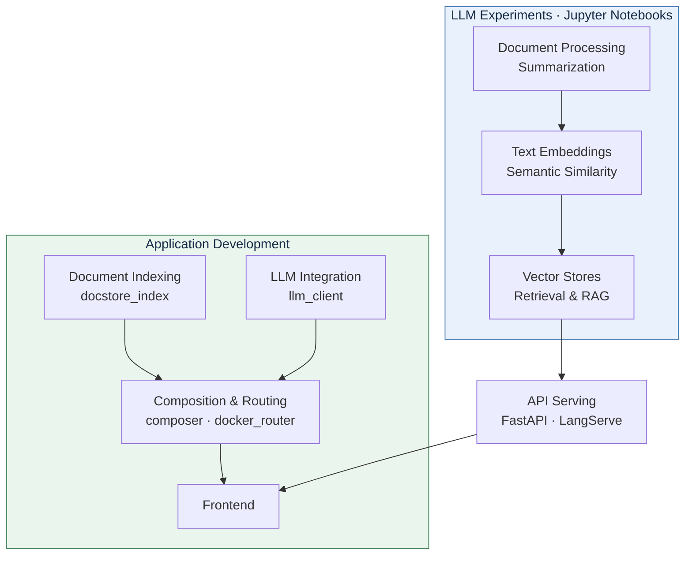

# LLM Application Development with LangChain

This repository explores practical applications of Large Language Models (LLMs) using **LangChain**, covering document processing, text embeddings, semantic search, Retrieval-Augmented Generation (RAG), conversational memory, and API integration.

It combines Jupyter Notebook experiments with application components to demonstrate different stages of building LLM-powered applications.

## Architecture and Learning Path

The repository covers two complementary areas: experimentation with core LLM concepts and the development of an application-serving workflow.



## Notebook Overview

### 1. `Documents_Summarization.ipynb` — Long-Document Processing and Summarization

- Loads research papers from arXiv using LangChain document loaders.
- Splits long documents into manageable chunks.
- Explores structured summarization using Pydantic models.
- Implements progressive summarization, maintaining a running summary, main ideas, and unresolved questions.

### 2. `Embeddings.ipynb` — Text Embeddings and Semantic Similarity

- Integrates NVIDIA's embedding API using `NVIDIAEmbeddings`.
- Experiments with the `nvidia/nv-embed-v1` embedding model.
- Generates query and document embeddings.
- Calculates cosine similarity and visualizes semantic relationships using a cross-similarity matrix.

### 3. `creating_vectorstores.ipynb` — Vector Stores and Retrieval-Augmented Generation

- Loads and splits research documents using `RecursiveCharacterTextSplitter`.
- Generates document embeddings and stores them in FAISS vector indexes.
- Combines vector indexes and implements semantic retrieval.
- Develops a conversational RAG pipeline with retrieval and conversational memory.
- Provides an interactive chatbot interface using Gradio.

### 4. `final_langserve_server.ipynb` — LLM Application Serving

- Builds an API server using FastAPI and LangServe.
- Exposes LangChain components through separate endpoints for chat, retrieval, and generation.
- Loads an existing FAISS index for document retrieval.
- Explores integration between the backend API and the frontend application.

## Application Components

The repository also contains separate application directories:

| Directory | Focus |
|---|---|
| `composer/` | Application composition |
| `docker_router/` | Docker-based routing components |
| `docstore_index/` | Document storage and indexing |
| `llm_client/` | LLM client integration |
| `frontend/` | User interface |
| `imgs/` | Project images and visual assets |

These components complement the notebook experiments and provide an additional view of application development beyond isolated LLM workflows.

## Technology Stack

- **Language:** Python
- **LLM Framework:** LangChain, LangServe
- **Embeddings:** NVIDIA Embeddings API
- **Vector Search:** FAISS
- **Document Processing:** LangChain loaders, RecursiveCharacterTextSplitter
- **Data Validation:** Pydantic
- **Backend:** FastAPI
- **Interfaces:** Gradio, frontend application
- **Containerization:** Docker

## Getting Started

Clone the repository:

```bash
git clone https://github.com/litoguemi/langchain_course.git
cd langchain_course
```

Install JupyterLab if it is not already available:

```bash
pip install jupyterlab
```

Launch the notebooks:

```bash
jupyter lab
```

The notebooks can be explored individually. For the RAG workflow, start with `Embeddings.ipynb` and `creating_vectorstores.ipynb`, followed by `final_langserve_server.ipynb`.

### Configuration

Some notebooks and application components require external API credentials, including NVIDIA API access. Configure credentials through environment variables or a `.env` file, and never commit API keys or tokens to the repository.

Check the individual notebook or application instructions for additional dependencies and configuration requirements.

## Scope and Limitations

This repository is a collection of practical experiments and application components rather than a single production-ready system. Some integrations, particularly the LangServe retrieval endpoint, require further testing and validation.

Dependency versions and execution instructions should be standardized to improve reproducibility.
